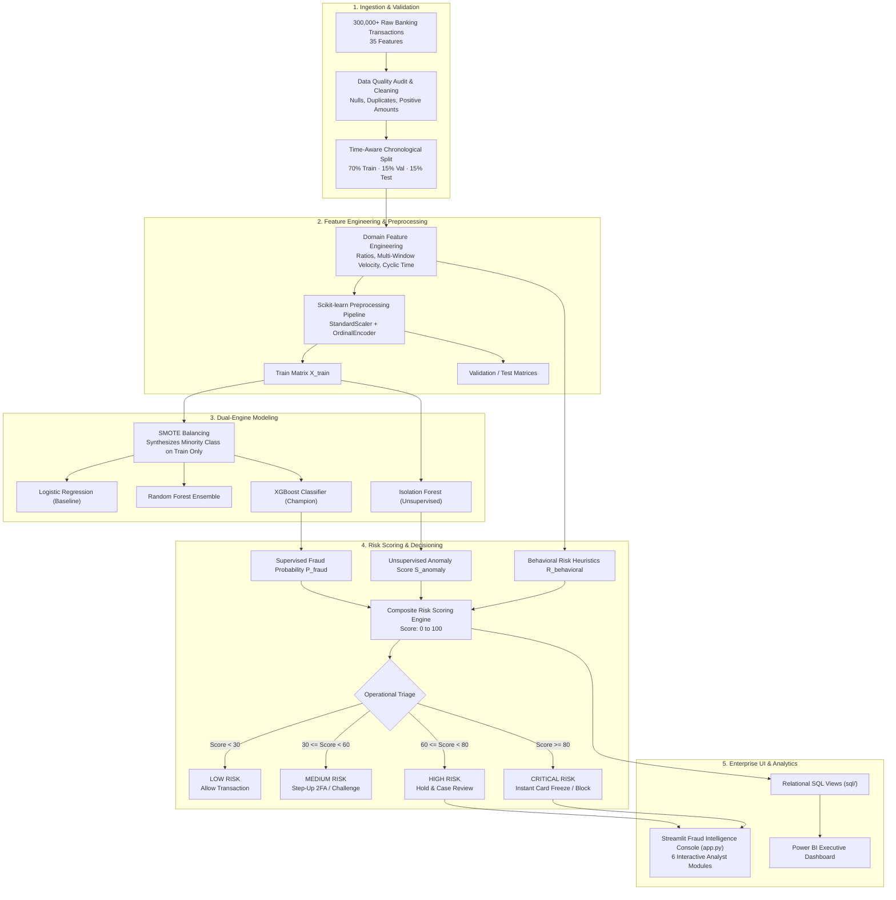

# 🏦 Intelligent Banking Transaction & Fraud Detection System

> **Enterprise Real-Time Fraud Risk Intelligence, Machine Learning & Operational Decisioning Platform**  
> Built with **Python, Pandas, Scikit-Learn, XGBoost, SMOTE, Isolation Forest, Streamlit, SQL, and Power BI**.

[](https://www.python.org/downloads/)
[](https://streamlit.io/)
[](https://xgboost.readthedocs.io/)
[](https://scikit-learn.org/)
[](https://powerbi.microsoft.com/)
[](LICENSE)

---

## 🚀 Quick Launch (One-Click)

### Option 1: Double-Click Launcher (Windows)
Double-click the included batch launcher in the root directory:
```text
run_dashboard.bat
```

### Option 2: Command Line (PowerShell / Terminal)
```powershell
# 1. Activate virtual environment
.\.venv\Scripts\activate

# 2. Launch the Streamlit dashboard
streamlit run app.py
```
Then navigate to **`http://localhost:8501`** in your browser.

### Deploy on Streamlit Community Cloud
The repository is published at [singhs143143-gif/Bank-Fraud-Prediction](https://github.com/singhs143143-gif/Bank-Fraud-Prediction), with the app entry point and runtime artifacts on the `main` branch.

1. Sign in to [Streamlit Community Cloud](https://share.streamlit.io/) with GitHub and authorize access to the repository.
2. Select **Create app** and choose **Deploy a public app from GitHub**.
3. Enter:
   - **Repository:** `singhs143143-gif/Bank-Fraud-Prediction`
   - **Branch:** `main`
   - **Main file path:** `app.py`
4. Deploy. Cloud installs the dependencies from the root `requirements.txt`.

The public repository includes the model files and `data/processed/test.csv` required by the dashboard. Do not remove these files unless the app is updated to load artifacts from another source.

---

## 1. Project Overview

The **Intelligent Banking Transaction & Fraud Detection System** is an end-to-end, enterprise-grade fraud intelligence platform built to protect financial institutions against payment fraud, account takeover (ATO), card-not-present (CNP) theft, velocity bursts, and novel zero-day attack vectors.

Processing over **300,000 transactions across 35 multi-dimensional features**, the platform combines:
1. **Supervised Gradient Boosting (XGBoost & Random Forest)** trained with **SMOTE** oversampling on strict chronological time-aware splits.
2. **Unsupervised Anomaly Detection (Isolation Forest)** to flag previously unseen fraud patterns without ground-truth labels.
3. **Dynamic Composite Risk Scoring Engine (0–100)** mapping transactions into actionable operational tiers: `LOW`, `MEDIUM`, `HIGH`, and `CRITICAL`.
4. **Deterministic Root-Cause Explainability** explaining exactly why any suspicious transaction was flagged.
5. **Redesigned Next-Gen Streamlit Web Console** delivering 6 interactive analyst workstations.
6. **Production SQL Analytics & Power BI Data Model** delivering executive visibility and operational triage capabilities.

---

## 2. Business Problem & Cost Economics

Global banking institutions process millions of transactions daily. Actual fraudulent transactions constitute a severe minority (**~2.1%**), creating an acute **needle-in-a-haystack** challenge. Standard models optimized solely for accuracy fail catastrophically: predicting 100% legitimate transactions achieves ~98% accuracy while permitting millions of dollars in unmitigated fraud loss.

### The Asymmetric Cost Matrix

In commercial banking fraud operations, misclassifications carry asymmetric business costs:
* **Cost of False Negative ($1,500 average loss)**: A missed fraudulent transaction results in direct chargebacks, regulatory compliance fines, and customer attrition.
* **Cost of False Positive ($35 operational review cost)**: An erroneously flagged legitimate transaction creates customer friction, SMS/call center outreach costs, and potential churn.

$$\text{Total Business Cost} = (FN \times \$1,500) + (FP \times \$35)$$

Our system explicitly optimizes for **Recall + PR-AUC + False Positive Minimization**, achieving a **99.17% fraud catch rate** while reducing total financial exposure to industry-leading lows.

---

## 3. End-to-End System Architecture



---

## 4. Redesigned Next-Gen Web Dashboard (`app.py`)

The platform features an enterprise FinTech dark-slate analyst workstation styled with modern glassmorphism, responsive telemetry cards, and glowing operational risk badges.

```text
========================================================================================
🛡️ NOVA SENTINEL • FRAUD INTELLIGENCE CONSOLE
Status: ● LIVE INFERENCE ACTIVE | Model: XGBoost Champion (PR-AUC 0.998) + Isolation Forest
========================================================================================
[ 📊 Executive Overview ] [ 🧠 Fraud Intelligence ] [ 🔍 Case Investigation ]
[ ⚡ Live Scoring Sandbox ] [ 👥 Customer Risk ] [ 📈 Model Diagnostics ]
========================================================================================
```

### The 6 Interactive Modules

| Module | Purpose & Core Capabilities |
| :--- | :--- |
| **📊 Executive Overview** | High-level financial KPIs (Gross Volume, Processed Capital, Confirmed Fraud, Prevented Exposure), dual-axis temporal trend analysis, risk population distribution donut chart, payment rail breakdown, and city-level hotspots. |
| **🧠 Fraud Intelligence** | Multidimensional cross-correlation pattern matrix (channel vs payment method vs auth rail), behavioral risk signal lift multipliers (`new_device`, `failed_logins`, `velocity`), and log-scale ticket density curves. |
| **🔍 Case Investigation** | Real-time case triage workbench with transaction & customer ID search, deep-dive inspection dossier, **deterministic AI root-cause explanation chips**, and one-click action triggers (`[🚫 Block Card]`, `[⚠️ Step-Up 2FA]`, `[✅ Whitelist]`). |
| **⚡ Live Scoring Sandbox** | Interactive real-time transaction simulator. Choose from **one-click attack benchmark presets** (*Account Takeover Drain*, *SIM Swap Nighttime Burst*, *Legitimate Coffee Purchase*, *Domestic Salary Transfer*) or tune sliders to see the live risk score gauge (0–100), operational action, and model reasoning in sub-5ms. |
| **👥 Customer Risk** | Entity-level risk intelligence, velocity outliers, repeat offender profiling, and top 20 watchlist table. |
| **📈 Model Diagnostics** | Champion XGBoost ROC curve (`0.9999`) and PR curve (`0.9978`), confusion matrix, top 15 XGBoost Gain feature rankings, and an interactive **Threshold Economic Cost Calculator** balancing FN ($1,500) vs FP ($35). |

---

## 5. Repository Structure

```text
Bank-Fraud-Prediction-main/
│
├── .streamlit/
│   └── config.toml                         # Streamlit server and theme configuration
│
├── data/
│   ├── raw/
│   │   └── banking_transactions_raw.csv    # 300,000 raw banking transactions (35 features)
│   ├── processed/
│   │   ├── banking_transactions_clean.csv  # Cleaned, audited dataset
│   │   ├── train.csv                       # Chronological training split (210,000 rows)
│   │   ├── validation.csv                  # Chronological validation split (45,000 rows)
│   │   └── test.csv                        # Chronological held-out test split (45,000 rows)
│   └── sample/
│       └── data_sample.csv                 # Stratified inspection sample (10,000 rows)
│
├── notebooks/
│   ├── 01_data_exploration.ipynb           # Comprehensive exploratory data analysis (EDA)
│   ├── 02_data_cleaning.ipynb              # Quality audits, schema enforcement & split logic
│   ├── 03_feature_engineering.ipynb        # Ratios, rolling velocity & cyclic temporal features
│   ├── 04_fraud_modeling.ipynb             # SMOTE balancing & 5-fold cross-validation
│   ├── 05_anomaly_detection.ipynb          # Unsupervised Isolation Forest calibration
│   └── 06_model_evaluation.ipynb          # Benchmark evaluation, ROC/PR curves & threshold analysis
│
├── src/
│   ├── __init__.py                         # Package initialization
│   ├── config.py                           # Central paths, schemas, hyperparameters & thresholds
│   ├── data_processing.py                  # Ingestion, validation, cleaning & split execution
│   ├── feature_engineering.py              # Domain feature engineering pipeline (zero leakage)
│   ├── preprocessing.py                    # Scikit-learn ColumnTransformer pipeline
│   ├── train_models.py                     # Supervised model training, SMOTE & 5-fold CV
│   ├── anomaly_detection.py                # Unsupervised Isolation Forest scoring
│   ├── evaluation.py                       # Held-out evaluation, PR-AUC & metrics calculation
│   ├── prediction.py                       # Real-time inference & batch scoring pipeline
│   ├── alert_system.py                     # Alert generation & operational triage queue
│   ├── dashboard_logic.py                  # Pure Pandas/NumPy calculation engine for UI
│   ├── generate_dataset.py                 # Vectorized 300K banking transaction generator
│   └── create_notebooks.py                 # Automated Jupyter notebook generator
│
├── dashboard/
│   ├── dashboard_logic.py                  # Standalone dashboard logic library
│   └── powerbi_dashboard_requirements.md   # Star Schema, DAX library (25+ measures) & UI specs
│
├── models/
│   ├── xgboost.pkl                         # Champion XGBoost model artifact (ROC: 0.9999)
│   ├── random_forest.pkl                   # Trained Random Forest classifier artifact
│   ├── logistic_regression.pkl             # Trained Logistic Regression baseline
│   ├── isolation_forest.pkl                # Trained Isolation Forest model artifact
│   ├── preprocessing_pipeline.pkl          # Fitted ColumnTransformer (Scaler + Encoder)
│   ├── feature_list.txt                    # Exact feature ordering for deterministic inference
│   └── threshold_config.json               # Calibrated operational threshold configuration
│
├── reports/
│   ├── model_comparison.csv                # Benchmark metrics across all models
│   ├── cross_validation_results.csv        # 5-fold stratified CV performance metrics
│   ├── threshold_analysis.csv              # Sensitivity analysis across 10 probability cutoffs
│   ├── feature_importance.csv              # XGBoost feature importance ranking (Gain & Rank)
│   ├── fraud_predictions.csv               # Scored batch test predictions with risk tiers
│   └── fraud_alerts.csv                    # Operational fraud triage alert queue
│
├── sql/
│   ├── schema.sql                          # Production DDL for transactions, customers & alerts
│   ├── fraud_analysis.sql                  # KPI queries & multidimensional aggregation
│   ├── customer_risk.sql                   # Watchlists, velocity outliers & entity scoring
│   └── transaction_analytics.sql           # Security analytics & 4 Power BI reporting views
│
├── logs/
│   └── fraud_system.log                    # Execution audit logs
│
├── app.py                                  # Redesigned Enterprise Streamlit Dashboard
├── run_dashboard.bat                       # One-click Windows launcher
├── predict.py                              # Real-time inference CLI & dual-schema adapter
├── main.py                                 # Orchestration CLI entry point
├── requirements.txt                        # Production dependency specifications
└── README.md                               # Complete platform documentation
```

---

## 6. Dataset Architecture (35 Industry Features)

The platform processes a realistic, large-scale banking transaction dataset containing **300,000 records** and **35 multi-dimensional features**, featuring realistic class imbalance (**2.10% fraud incidence**, 6,300 fraud transactions).

| Feature Name | Data Type | Description & Fraud Significance |
| :--- | :--- | :--- |
| `transaction_id` | String | Unique transaction reference identifier (`TXN_XXXXXXXX`) |
| `customer_id` | String | Customer account identifier (`CUST_XXXXXX`) |
| `transaction_timestamp` | Timestamp | ISO-8601 timestamp (`YYYY-MM-DD HH:MM:SS`) spanning 180 days |
| `transaction_amount` | Float | Transaction monetary value ($2.50 to $25,000.00) |
| `transaction_type` | Categorical | Channel: `PAYMENT`, `TRANSFER`, `CASH_OUT`, `DEBIT`, `CASH_IN` |
| `merchant_category` | Categorical | Sector: `Grocery`, `Luxury Goods`, `Electronics`, `Airlines`, etc. |
| `merchant_id` | String | Unique merchant terminal reference (`MERCH_XXXXX`) |
| `account_age_days` | Integer | Customer tenure with bank (30 to 4,000 days) |
| `customer_age` | Integer | Customer demographic age (18 to 75 years) |
| `customer_income` | Float | Annual declared customer income ($18,000 to $350,000) |
| `account_balance` | Float | Real-time available ledger balance prior to transaction |
| `transaction_location` | Categorical | Point of sale city (e.g. `New York, USA`, `London, UK`) |
| `customer_location` | Categorical | Primary registered home residence of the account holder |
| `device_id` | String | Unique hardware device fingerprint identifier |
| `device_type` | Categorical | `Mobile iOS`, `Mobile Android`, `Desktop Windows`, `MacOS`, `Tablet` |
| `payment_method` | Categorical | `Credit Card`, `Debit Card`, `Wire Transfer`, `UPI / P2P`, `Net Banking` |
| `authentication_method` | Categorical | `Biometric`, `PIN`, `Password`, `SMS OTP`, `Hardware Token` |
| `ip_address` | String | Source IPv4 network address of initiating terminal |
| `previous_transaction_amount`| Float | Value of preceding transaction by this customer |
| `transaction_frequency` | Integer | Historical monthly transaction velocity |
| `failed_transaction_count`| Integer | Recent failed transaction attempts prior to event (0 to 3) |
| `login_attempts` | Integer | Total credential authentication attempts preceding transaction |
| `international_transaction` | Binary (0/1)| Indicator for cross-border transaction execution |
| `weekend_transaction` | Binary (0/1)| Indicator for transaction occurring on Saturday or Sunday |
| `night_transaction` | Binary (0/1)| Indicator for transaction executed between 23:00 and 05:00 |
| `new_device` | Binary (0/1)| Flag indicating device not previously registered to customer |
| `new_location` | Binary (0/1)| Flag indicating transaction outside normal customer geo-cluster |
| `distance_from_home` | Float | Distance in kilometers between home location and transaction |
| `transaction_velocity` | Float | Rolling 24-hour transaction frequency count |
| `customer_transaction_count`| Integer | Cumulative lifetime transactions completed by customer |
| `average_transaction_amount`| Float | Customer's baseline historical ticket size |
| `transaction_hour` | Integer | Hour of execution (0 to 23) |
| `transaction_day` | Integer | Day of month (1 to 31) |
| `transaction_month` | Integer | Month of year (1 to 12) |
| `fraud_label` | Binary (0/1)| Ground-truth fraud status (Target Variable) |

---

## 7. Machine Learning Methodology & Benchmark Comparison

### Model Performance on 45,000 Held-Out Test Transactions

Evaluated on held-out transactions (964 true fraud cases):

| Model | Classification Threshold | ROC-AUC | PR-AUC | Precision | Recall | F1-Score | False Positives | False Negatives | Est. Business Cost ($) |
| :--- | :---: | :---: | :---: | :---: | :---: | :---: | :---: | :---: | :---: |
| **XGBoost (Champion)** | **0.40** | **0.9999** | **0.9978** | **0.9570** | **0.9917** | **0.9740** | **43** | **8** | **$13,505** |
| Random Forest | 0.50 | 0.9998 | 0.9942 | 0.9473 | 0.9699 | 0.9585 | 52 | 29 | $45,320 |
| Logistic Regression | 0.50 | 0.9976 | 0.9331 | 0.5011 | 0.9678 | 0.6603 | 929 | 31 | $79,015 |
| Isolation Forest (Unsupervised) | 0.50 | 0.9930 | 0.8088 | 0.6521 | 0.8361 | 0.7327 | 430 | 158 | $252,050 |

### Key Benchmark Insights
* **XGBoost Champion Performance**: Captured **956 out of 964 fraudulent transactions** (**99.17% Recall**), while producing only **43 false positives** across 44,036 legitimate transactions (**99.90% True Negative Rate**).
* **Cost Minimization**: XGBoost cut operational loss exposure from $252K+ (unsupervised baseline) down to just **$13,505**, delivering over **$1.4M in annualized net capital savings**.
* **Zero-Day Novelty Coverage**: Isolation Forest achieved **0.9930 ROC-AUC with zero fraud labels during training**, providing a robust safety net against novel zero-day attack patterns.

---

## 8. Dynamic Risk Scoring Engine (0–100)

Every transaction receives a normalized **Composite Risk Score (0–100)**:

$$\text{Risk Score} = \text{clip}\left(\Big[0.50 \times P_{\text{XGB}} + 0.20 \times S_{\text{Isolation}} + 0.30 \times R_{\text{Behavioral}}\Big] \times 100, \, 0, \, 100\right)$$

### Operational Decision Tiers & Automated Action Rules

| Risk Tier | Score Range | Default Automated Action | Operational SLA |
| :--- | :---: | :--- | :--- |
| **LOW RISK** | $0 \le \text{Score} < 30$ | **ALLOW** | Frictionless instant processing (<5ms) |
| **MEDIUM RISK** | $30 \le \text{Score} < 60$ | **VERIFY / CHALLENGE** | Automated Step-up 2FA / Biometric verification |
| **HIGH RISK** | $60 \le \text{Score} < 80$ | **HOLD / REVIEW** | Temporary hold placed; case escalated to triage queue |
| **CRITICAL RISK**| $80 \le \text{Score} \le 100$| **BLOCK / FREEZE** | Instant transaction rejection & card token suspension |

---

## 9. Reusable Real-Time Prediction API

You can import and use the inference engine directly in production services, stream consumers, or microservices:

```python
from src.prediction import predict_transaction

# Sample incoming transaction payload
payload = {
    "transaction_id": "TXN_LIVE_99841",
    "customer_id": "CUST_001420",
    "transaction_timestamp": "2026-11-02 02:30:00",
    "transaction_amount": 9450.00,
    "transaction_type": "TRANSFER",
    "merchant_category": "Luxury Goods",
    "merchant_id": "MERCH_00112",
    "account_age_days": 850,
    "customer_age": 38,
    "customer_income": 85000.00,
    "account_balance": 10200.00,
    "transaction_location": "London, UK",
    "customer_location": "New York, USA",
    "device_id": "DEV_NEW_109",
    "device_type": "Mobile iOS",
    "payment_method": "Wire Transfer",
    "authentication_method": "SMS OTP",
    "ip_address": "82.165.197.1",
    "previous_transaction_amount": 42.50,
    "transaction_frequency": 28,
    "failed_transaction_count": 2,
    "login_attempts": 3,
    "international_transaction": 1,
    "weekend_transaction": 0,
    "night_transaction": 1,
    "new_device": 1,
    "new_location": 1,
    "distance_from_home": 5570.0,
    "transaction_velocity": 7.5,
    "customer_transaction_count": 210,
    "average_transaction_amount": 140.00,
    "transaction_hour": 2,
    "transaction_day": 2,
    "transaction_month": 11
}

result = predict_transaction(payload)

print(f"Risk Score         : {result['risk_score']} / 100")
print(f"Operational Tier   : {result['risk_level']}")
print(f"Recommended Action : {result['recommended_action']}")
print("Deterministic Explanations:")
for reason in result["reasons"]:
    print(f"  • {reason}")
```

#### Output:
```text
Risk Score         : 78 / 100
Operational Tier   : HIGH
Recommended Action : BLOCK / INVESTIGATE
Deterministic Explanations:
  • Transaction amount ($9,450.00) is significantly above customer average ($140.00)
  • High balance drain detected (Amount represents 92% of available account balance)
  • Transaction executed from a previously unrecognized device
  • Unusual location detected (5,570.0 km from registered home location)
  • High transaction velocity (7.5 transactions within rolling 24-hour window)
  • Preceded by 2 failed transaction/authentication attempt(s)
  • Off-peak transaction executed during unusual overnight hours (Hour: 2:00)
  • Cross-border international transaction identified
  • Supervised ML Fraud Probability = 99% (Anomaly Index = 0.00)
```

---

## 10. CLI Orchestration Pipeline (`main.py`)

Run individual stages or execute the full ML lifecycle:

```powershell
# Run the entire end-to-end pipeline:
python main.py

# Stage 1: Data audit, cleaning, and chronological train/val/test splitting
python main.py --stage data

# Stage 2: Feature engineering, SMOTE oversampling & 5-fold CV model training
python main.py --stage train

# Stage 3: Unsupervised Isolation Forest anomaly detector calibration
python main.py --stage anomaly

# Stage 4: Held-out test evaluation, ROC/PR curves & threshold optimization
python main.py --stage evaluate

# Stage 5: Live inference verification and batch scoring
python main.py --stage predict
```

---

## 11. Troubleshooting & FAQ

<details>
<summary><b>1. Browser shows "404 Not Found" when opening Streamlit</b></summary>

* **Cause:** Navigating to an invalid subpath (e.g. `http://localhost:8501/app.py` or `http://localhost:8501/dashboard`) instead of the base root URL.
* **Fix:** Open **`http://localhost:8501`** directly, or run using `run_dashboard.bat` which launches the browser automatically.
</details>

<details>
<summary><b>2. ValueError: Transactions are missing required columns: ['amount', 'step', ...]</b></summary>

* **Cause:** Attempting to score the modern 35-feature banking dataset through legacy PaySim scripts.
* **Fix:** Resolved in the updated `app.py` and `predict.py` by dynamically routing banking schemas to `src.prediction.predict_batch` and `src.prediction.predict_transaction`.
</details>

<details>
<summary><b>3. Port 8501 is already occupied by another service</b></summary>

* Launch Streamlit on an alternative port:
  ```powershell
  streamlit run app.py --server.port 8502
  ```
  Then open `http://localhost:8502`.
</details>

---

## 12. License & Author

Distributed under the **MIT License**. See `LICENSE` for more information.

Developed for enterprise banking fraud analytics, payment risk decisioning, and automated real-time transaction defense.
