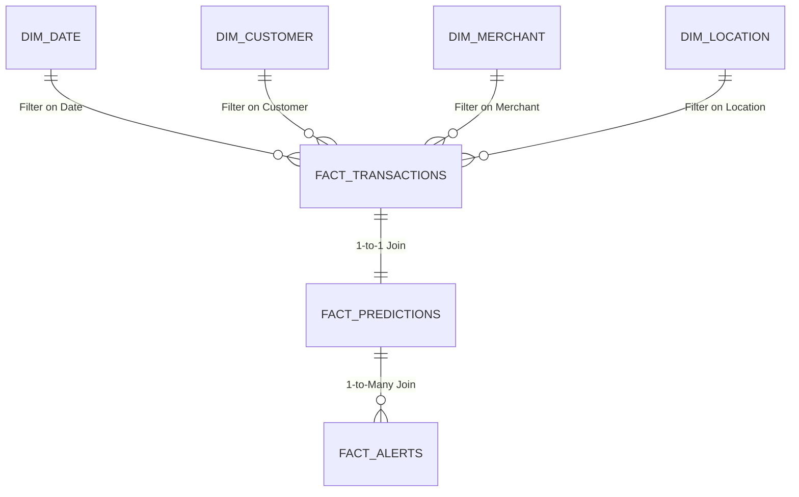

# 📊 Power BI Dashboard Requirements & Enterprise Analytics Architecture
## Intelligent Banking Transaction & Fraud Detection System

---

## 1. Executive Summary & Purpose

The **Intelligent Banking Fraud Analytics Platform** Power BI dashboard is designed for Chief Risk Officers (CRO), Fraud Operations Managers, and Senior Fraud Analysts. It transforms complex machine learning inferences and behavioral transaction telemetry into actionable operational intelligence.

The dashboard consists of four interconnected reporting pages:
1. **Executive Fraud Overview** — High-level financial KPIs, operational fraud exposure, loss mitigation, and temporal trends.
2. **Customer Risk Intelligence** — Entity-level behavioral profiling, account exposure, velocity anomalies, and watchlist prioritization.
3. **Transaction Investigation Console** — Low-latency triage queue with human-readable explanations, anomaly scores, and analyst action triggers.
4. **Model Performance & Calibration** — Production ML governance, ROC/PR curves, confusion matrices, threshold trade-offs, and feature importance.

---

## 2. Power BI Data Model (Star Schema)

The dashboard operates on a high-performance **Star Schema** data model optimized for DirectLake or Fast Import modes.



### Table Relationships & Cardinality

| From Table | From Column | To Table | To Column | Cardinality | Cross Filter Direction |
| :--- | :--- | :--- | :--- | :--- | :--- |
| `dim_date` | `Date` | `fact_transactions` | `transaction_date` | 1 to Many (`1:*`) | Single |
| `dim_customer` | `customer_id` | `fact_transactions` | `customer_id` | 1 to Many (`1:*`) | Single |
| `dim_merchant` | `merchant_id` | `fact_transactions` | `merchant_id` | 1 to Many (`1:*`) | Single |
| `dim_location` | `location_name` | `fact_transactions` | `transaction_location`| 1 to Many (`1:*`) | Single |
| `fact_transactions` | `transaction_id`| `fact_predictions` | `transaction_id` | 1 to 1 (`1:1`) | Both |
| `fact_predictions` | `transaction_id` | `fact_alerts` | `transaction_id` | 1 to Many (`1:*`) | Single |

---

## 3. Financial UI Theme & Styling Guide

* **Canvas Background**: Light Slate `#F8FAFC`
* **Card/Tile Containers**: Pure White `#FFFFFF` with 1px border `#E2E8F0` and 4px radius
* **Primary Typography**: Segoe UI / Aptos, Bold Header `#0F172A`, Subtext `#475569`
* **Semantic Color Tokens**:
  * **Critical / High Risk / Fraud**: Crimson Alert `#DC2626`
  * **Medium Risk / Warning**: Amber Alert `#D97706`
  * **Low Risk / Safe**: Emerald Green `#059669`
  * **Primary Accent / Brand**: Deep Navy `#1E293B`
  * **Secondary Brand**: Cobalt Blue `#2563EB`

---

## 4. Complete DAX Measures Library

Create a dedicated measure table: `_Measures`.

### 4.1 Volume & Financial Metrics

```dax
-- Total Transaction Volume
Total Transactions = COUNTROWS(fact_transactions)

-- Total Dollar Volume
Total Volume ($) = SUM(fact_transactions[transaction_amount])

-- Total Fraud Count
Fraud Transactions = CALCULATE(
    COUNTROWS(fact_transactions),
    fact_transactions[fraud_label] = 1
)

-- Total Fraud Losses (Ground Truth)
Total Fraud Loss ($) = CALCULATE(
    SUM(fact_transactions[transaction_amount]),
    fact_transactions[fraud_label] = 1
)

-- Overall Fraud Incidence Rate (%)
Fraud Rate (%) = DIVIDE([Fraud Transactions], [Total Transactions], 0) * 100

-- Average Ticket Size
Average Ticket Size ($) = AVERAGE(fact_transactions[transaction_amount])

-- Average Fraud Ticket Size
Average Fraud Amount ($) = CALCULATE(
    AVERAGE(fact_transactions[transaction_amount]),
    fact_transactions[fraud_label] = 1
)
```

### 4.2 ML Model Detection & Operational Triage Metrics

```dax
-- High Risk Flagged Transactions
High Risk Transactions = CALCULATE(
    COUNTROWS(fact_predictions),
    fact_predictions[risk_level] = "HIGH"
)

-- True Positives (Model flagged High and actual Fraud)
True Positives (TP) = CALCULATE(
    COUNTROWS(fact_transactions),
    fact_transactions[fraud_label] = 1,
    RELATED(fact_predictions[risk_level]) = "HIGH"
)

-- False Positives (Model flagged High on Legitimate Transaction)
False Positives (FP) = CALCULATE(
    COUNTROWS(fact_transactions),
    fact_transactions[fraud_label] = 0,
    RELATED(fact_predictions[risk_level]) = "HIGH"
)

-- False Negatives (Model missed actual Fraud)
False Negatives (FN) = CALCULATE(
    COUNTROWS(fact_transactions),
    fact_transactions[fraud_label] = 1,
    RELATED(fact_predictions[risk_level]) <> "HIGH"
)

-- True Negatives (Model correctly allowed Legitimate)
True Negatives (TN) = CALCULATE(
    COUNTROWS(fact_transactions),
    fact_transactions[fraud_label] = 0,
    RELATED(fact_predictions[risk_level]) <> "HIGH"
)

-- Operational Fraud Recall / Detection Rate
Fraud Detection Rate (%) = DIVIDE([True Positives (TP)], [Fraud Transactions], 0) * 100

-- Precision of Alerts
Alert Precision (%) = DIVIDE([True Positives (TP)], [True Positives (TP)] + [False Positives (FP)], 0) * 100

-- False Positive Rate
False Positive Rate (%) = DIVIDE([False Positives (FP)], [False Positives (FP)] + [True Negatives (TN)], 0) * 100

-- F1 Score
F1 Score = 
VAR P = [Alert Precision (%)] / 100
VAR R = [Fraud Detection Rate (%)] / 100
RETURN
DIVIDE(2 * P * R, P + R, 0)

-- Financial Value of Fraud Prevented
Fraud Losses Prevented ($) = CALCULATE(
    SUM(fact_transactions[transaction_amount]),
    fact_transactions[fraud_label] = 1,
    RELATED(fact_predictions[risk_level]) = "HIGH"
)

-- Net Loss from Missed Fraud
Net Fraud Leakage ($) = CALCULATE(
    SUM(fact_transactions[transaction_amount]),
    fact_transactions[fraud_label] = 1,
    RELATED(fact_predictions[risk_level]) <> "HIGH"
)
```

---

## 5. Detailed Page-by-Page Specifications

### Page 1 — Executive Fraud Overview

* **Target Audience**: Chief Risk Officer, Executive Leadership.
* **Objective**: Monitor macroeconomic fraud trends, financial loss mitigation, and channel exposure.

#### Top KPI Cards (Row 1, 8 KPI Tiles across header)
1. **Total Transactions**: `[Total Transactions]` (Formatted: `#,##0`)
2. **Total Transaction Volume**: `[Total Volume ($)]` (Formatted: `$#,##0.00 M`)
3. **Confirmed Fraud Cases**: `[Fraud Transactions]` (Formatted: `#,##0`)
4. **Total Fraud Losses**: `[Total Fraud Loss ($)]` (Formatted: `$#,##0 K`, Font Color `#DC2626`)
5. **Incidence Fraud Rate**: `[Fraud Rate (%)]` (Formatted: `0.000%`)
6. **High-Risk Flagged**: `[High Risk Transactions]` (Formatted: `#,##0`, Font Color `#D97706`)
7. **Model Detection Rate**: `[Fraud Detection Rate (%)]` (Formatted: `99.17%`, Font Color `#059669`)
8. **Losses Prevented**: `[Fraud Losses Prevented ($)]` (Formatted: `$#,##0 K`, Font Color `#059669`)

#### Main Visuals
* **Visual 1 (Top Left)**: Line & Clustered Column Chart — *Daily Fraud Trend & 7-Day Moving Average*
  * X-Axis: `dim_date[Date]`
  * Column Values: `[Fraud Transactions]`
  * Line Values: `[Total Fraud Loss ($)]`
* **Visual 2 (Top Right)**: Donut Chart — *Risk Tier Distribution*
  * Legend: `fact_predictions[risk_level]` (LOW / MEDIUM / HIGH)
  * Values: `[Total Transactions]`
  * Palette: Crimson (`#DC2626`), Amber (`#D97706`), Emerald (`#059669`)
* **Visual 3 (Bottom Left)**: Clustered Bar Chart — *Fraud Losses by Transaction Type*
  * Y-Axis: `fact_transactions[transaction_type]` (TRANSFER, CASH_OUT, PAYMENT, etc.)
  * X-Axis: `[Total Fraud Loss ($)]`
* **Visual 4 (Bottom Center)**: Treemap — *Fraud Exposure by Merchant Category*
  * Group: `fact_transactions[merchant_category]`
  * Values: `[Total Fraud Loss ($)]`
* **Visual 5 (Bottom Right)**: Filled Map / Bubble Map — *Geographical Fraud Heatmap*
  * Location: `fact_transactions[transaction_location]`
  * Bubble Size: `[Total Fraud Loss ($)]`
  * Tooltips: `[Fraud Transactions]`, `[Fraud Rate (%)]`

---

### Page 2 — Customer Risk Intelligence

* **Target Audience**: Financial Crimes Unit, AML Investigators.
* **Objective**: Identify high-exposure accounts, compromised credentials, and velocity anomalies.

#### KPI Header
1. **Total Monitored Customers**: `DISTINCTCOUNT(fact_transactions[customer_id])`
2. **Watchlist Customers**: `COUNTROWS(FILTER(customer_risk_profiles, [customer_risk_tier] = "WATCHLIST"))`
3. **Critical Risk Customers**: `COUNTROWS(FILTER(customer_risk_profiles, [customer_risk_tier] = "CRITICAL RISK"))`
4. **Average Customer Risk Index**: `AVERAGE(customer_risk_profiles[customer_risk_score])`

#### Main Visuals
* **Visual 1 (Left 40% Width)**: Ranked Table — *Highest-Risk Customer Watchlist*
  * Columns: `customer_id`, `customer_location`, `customer_risk_tier`, `lifetime_txns`, `fraud_events`, `failed_logins`, `dynamic_risk_score`
  * Conditional Formatting: Data bar on `dynamic_risk_score` (Red to Green gradient)
* **Visual 2 (Top Right)**: Scatter Plot — *Customer Velocity vs Amount Deviation*
  * X-Axis: `fact_transactions[transaction_velocity]`
  * Y-Axis: `fact_transactions[amount_deviation_from_customer_average]`
  * Bubble Size: `fact_predictions[risk_score]`
  * Legend: `fact_transactions[fraud_label]`
* **Visual 3 (Bottom Right)**: Clustered Column Chart — *Failed Logins vs Resulting Fraud Events*
  * X-Axis: `fact_transactions[failed_transaction_count]` (0, 1, 2, 3+)
  * Y-Axis: `[Fraud Transactions]`

---

### Page 3 — Transaction Investigation Console

* **Target Audience**: Fraud Analysts, Tier 1/2 Triage Specialists.
* **Objective**: Interactive operational workbench for drilling down into flagged transactions and taking immediate block/allow actions.

#### Filter Bar / Slicers (Top Ribbon)
* **Date Range Slicer**: `dim_date[Date]` (Between range)
* **Risk Level Slicer**: `fact_predictions[risk_level]` (HIGH, MEDIUM, LOW)
* **Transaction Type Dropdown**: `fact_transactions[transaction_type]`
* **Merchant Category Dropdown**: `fact_transactions[merchant_category]`
* **Location Multi-Select**: `fact_transactions[transaction_location]`
* **Alert Status Slicer**: `fact_alerts[status]` (NEW, UNDER_REVIEW, RESOLVED)

#### Central Investigation Grid (Full-width Interactive Grid)
* **Columns**:
  1. `transaction_id` (Hyperlink style)
  2. `transaction_timestamp` (Format: `YYYY-MM-DD HH:MM:SS`)
  3. `customer_id`
  4. `transaction_amount` (Format: `$#,##0.00`)
  5. `merchant_category`
  6. `transaction_location`
  7. `device_type`
  8. `fraud_probability` (Data bar: 0.0 to 1.0)
  9. `anomaly_score` (Data bar: 0.0 to 1.0)
  10. `risk_score` (Color badge: Green < 30, Orange 30-70, Red >= 70)
  11. `risk_level` (Badge: LOW, MEDIUM, HIGH)
  12. `recommended_action` (BLOCK, VERIFY, ALLOW)
  13. `explanation_notes` (Text wrap with root causes)
  14. `alert_status` (NEW, UNDER_REVIEW, CONFIRMED)

---

### Page 4 — Model Performance & Calibration

* **Target Audience**: Lead Data Scientists, ML Engineers, Model Risk Governance.
* **Objective**: Continuous monitoring of machine learning model efficacy, drift detection, and threshold tuning.

#### Benchmark Model Comparison Matrix
* Standard Power BI Matrix visualizing `reports/model_comparison.csv`:
  * Rows: `Model` (Logistic Regression, Random Forest, XGBoost, Isolation Forest)
  * Values: `ROC-AUC`, `PR-AUC`, `Precision`, `Recall`, `F1-Score`, `False Positives`, `False Negatives`, `Estimated Business Cost ($)`

#### Calibration Visuals
* **Visual 1 (Top Left)**: Line Chart — *Threshold Sensitivity Analysis*
  * X-Axis: `reports/threshold_analysis.csv[threshold]` (0.10 to 0.90)
  * Y-Axis: `Precision`, `Recall`, `F1-Score`
  * Annotate optimal operating threshold at `0.40`.
* **Visual 2 (Top Right)**: 2x2 Matrix Grid — *Operational Confusion Matrix*
  * Actual Fraud: TP (`[True Positives (TP)]`), FN (`[False Negatives (FN)]`)
  * Actual Normal: FP (`[False Positives (FP)]`), TN (`[True Negatives (TN)]`)
* **Visual 3 (Bottom)**: Horizontal Bar Chart — *XGBoost Feature Importance Ranking*
  * Source: `reports/feature_importance.csv`
  * Y-Axis: `feature` (Top 15 features sorted by gain)
  * X-Axis: `importance`

---

## 6. Implementation & Deployment Instructions

1. **Database / View Connection**: In Power BI Desktop, select **Get Data -> SQL Server / PostgreSQL / ODBC**. Point to the database hosting `sql/schema.sql` and the reporting views in `sql/transaction_analytics.sql`.
2. **Import Model Comparison Files**: Add `reports/model_comparison.csv` and `reports/feature_importance.csv` for Page 4 visuals.
3. **Establish Model Relationships**: Ensure Star Schema cardinality matches the specification in Section 2.
4. **Load DAX Measures**: Copy and paste the DAX definitions from Section 4 into the `_Measures` table.
5. **Publish & Refresh**: Publish `.pbix` to Power BI Service / Fabric Workspace and configure scheduled hourly or daily refresh.
